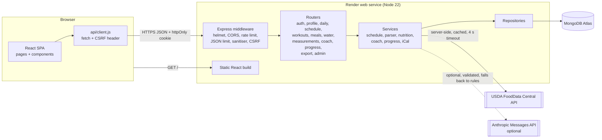

# Architecture

## 1. Overview



The client and API are served from **one origin**. That removes cross-site cookie problems, allows
`SameSite=Strict`, and means one URL to deploy and submit.

## 2. Layers and separation of concerns

| Layer | Responsibility | Never does |
|---|---|---|
| **Routes** (`routes/`) | HTTP: parse params, call validation, call a service, shape the response | Business rules, DB queries beyond the repository |
| **Middleware** (`middleware/`) | Cross-cutting: auth, validation, security headers, errors | Business logic |
| **Services** (`services/`) | Domain logic: scheduling, parsing, nutrition, coaching, analytics | Know about HTTP or Express |
| **Repositories** (`repositories/`) | Data access behind a small interface | Business rules |
| **Models** (`models/`) | Mongoose schemas, indexes, DB-level constraints | |
| **Validation** (`validation/`) | Zod schemas, the contract for every request body | |

Most services are **pure functions** (parser, schedule, progression, rule coach, iCal), so they are unit
tested without a server or database.

## 3. Design patterns

| Pattern | Where | Benefit |
|---|---|---|
| **Repository** | `MongoRepository` / `MemoryRepository` share one interface | Business logic is database-agnostic; the same test suite runs on both stores |
| **Factory** | `createRepositories()`, `ownedResourceRouter()`, `createApp()` | One generic CRUD router gives five resources consistent behaviour and ownership checks |
| **Dependency injection / composition root** | `createApp({ config, repos, usda, aiCoach })` | Tests inject fakes (USDA, AI) and an in-memory store |
| **Strategy** | Coach: AI strategy → rule strategy fallback | Optional AI without making the system depend on it |
| **Middleware chain (chain of responsibility)** | Express pipeline | Security concerns are composed once and applied everywhere |
| **Adapter** | `usdaClient.mapFood` | External JSON is converted to the internal nutrient shape |
| **Cache-aside** | `TtlCache` in the USDA client | Fewer API calls, faster responses, respects rate limits |
| **Provider (React context)** | `AuthContext`, `UiContext` | Shared state without prop drilling |
| **Custom hook** | `useApi()` | Loading, error and stale-response handling written once |

## 4. Data model

```mermaid
erDiagram
  USER ||--o{ DAILY_LOG : has
  USER ||--o{ WORKOUT : logs
  USER ||--o{ MEAL : logs
  USER ||--o{ WATER : logs
  USER ||--o{ MEASUREMENT : records
  USER ||--o{ REVIEW : receives
  USER { ObjectId _id; string email UK; string passwordHash; string role; int tokenVersion; object profile }
  DAILY_LOG { ObjectId userId; string date; number weightKg; number sleepHours; number steps; int energy; bool painFlag; string dayStatus }
  WORKOUT { ObjectId userId; string date; string session; array exercises; array cardio; string rawText }
  MEAL { ObjectId userId; string date; string time; string slot; string description; array items; object totals }
  WATER { ObjectId userId; string date; string time; int ml }
  MEASUREMENT { ObjectId userId; string date; number waistCm; number bellyCm }
  REVIEW { ObjectId userId; string date; string kind; string source; object content }
```

Design decisions:
- **Documents embed what is read together.** A workout embeds its exercises and sets; a meal embeds its
  items and totals. One read renders a card.
- **Dates are `YYYY-MM-DD` strings in the user's calendar.** A late-night log never moves to the wrong day
  because of server time zones, and range queries are simple string comparisons.
- **Compound indexes** `{ userId, date }` on every collection; unique on `daily` and `measurements`
  (one per day), which also makes upserts safe.
- **Profile is embedded in the user.** It is always read with the user, and defaults are merged at read
  time (`profileDefaults.js`), so new settings need no migration.
- **Derived data is computed, not stored.** Totals are recomputed on save; progress analytics are
  computed per request over the chosen range, so there is no stale aggregate and no fixed end date.

## 5. Request lifecycle (example: save a meal)

1. React `MealEditor` → `api.post('/meals', body)` with `X-Requested-With` and the session cookie.
2. `helmet` → `cors` → `express.json({limit:'100kb'})` → `cookieParser` → `stripMongoOperators`.
3. `/api` router: `apiLimiter` → `requireCsrfHeader` → `requireAuth` (verify JWT, load user, check `tokenVersion`).
4. `validate(mealSchema)`: strict Zod parse; on failure, 400 with field messages.
5. `beforeSave`: if there are no items, `nutrition.estimate(description)` (local table → USDA API); totals are always recomputed.
6. `repos.meals.create({ ...data, userId: req.user.id })`: the owner comes from the session, never the body.
7. 201 JSON → the UI shows a toast and reloads the day; Progress reflects it on the next view.

## 6. Scalability

- **Stateless API**: sessions are signed tokens, so instances scale horizontally behind a load balancer.
  `tokenVersion` revocation costs one indexed user lookup per request, a deliberate trade-off.
- **Indexed queries** bounded by date ranges (progress endpoints cap ranges at two years).
- **External calls** are cached and time-boxed; nutrition items are looked up in parallel.
- **Next steps at scale**: Redis for rate-limit counters and the USDA cache (shared across instances),
  pre-aggregated weekly summaries, and a CDN for static assets.
